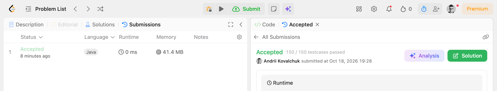
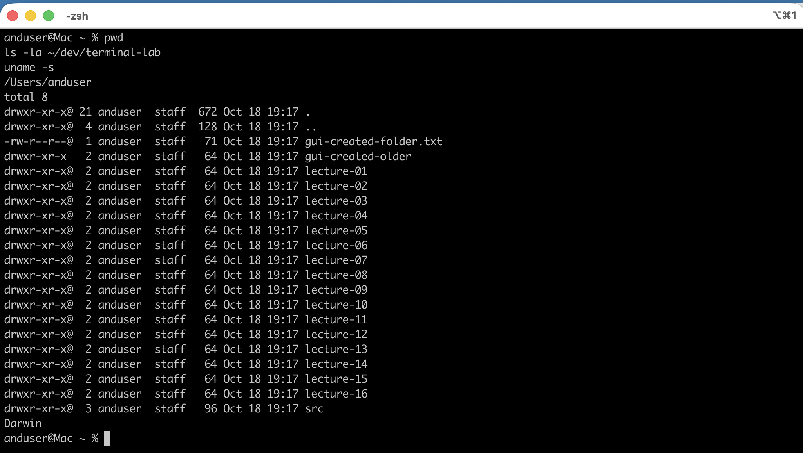
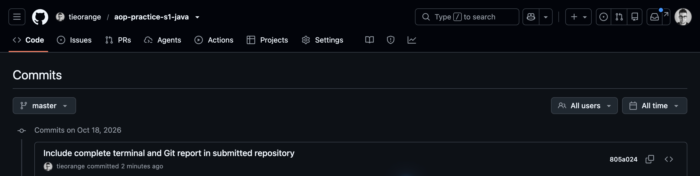

# Практична робота №1 — Вступ. Алгоритм і виконавець

- **Студент:** Ковальчук Андрій Олегович
- **Група:** ЧСБ24F301ДОФ26
- **Шаблон:** [djnzx/java-template](https://github.com/djnzx/java-template)
- **Java:** Oracle JDK 25.0.4.1 через локальний `jenv`

## Завдання Java

| Файл | Задача | Перевірений метод |
| --- | --- | --- |
| `homework.h01.T1` | [LeetCode 2413 — Smallest Even Multiple](https://leetcode.com/problems/smallest-even-multiple/) | `smallestEvenMultiple(int n)` |
| `homework.h01.T2` | [LeetCode 1523 — Count Odd Numbers in an Interval Range](https://leetcode.com/problems/count-odd-numbers-in-an-interval-range/) | `countOdds(int low, int high)` |

Для обох рішень додано unit-тести в `src/test/java/homework/h01/`.

### Перевірка на LeetCode

- [2413 — Accepted, 150/150 тестів](https://leetcode.com/problems/smallest-even-multiple/submissions/2175548152/)
- [1523 — Accepted, 84/84 тестів](https://leetcode.com/problems/count-odd-numbers-in-an-interval-range/submissions/2175548687/)




## DevOps і Git

Результати вправ з термінала та Git, включно з перевіркою оболонки, шляхів, Git identity і історії шаблону, наведені у [звіті в цьому репозиторії](docs/terminal-and-git.md).





## Відкрита дискусія

1. **Програма й алгоритм.** Алгоритм описує послідовність дій для розв’язання задачі, а програма є записом алгоритму мовою, яку можна виконати на комп’ютері.
2. **Навіщо мова програмування.** Процесор справді виконує машинні інструкції, але мови програмування дозволяють людині виразити задум зрозуміло; компілятор перекладає цей текст у форму для процесора.
3. **Чи зробить комп’ютер щось без вказівки.** Ні, він виконує лише інструкції програми та правила системи; неявно задані випадки також мають бути описані розробником.
4. **Чи є рецепт алгоритмом.** Так, якщо кроки впорядковані, однозначні та приводять до результату за скінченну кількість дій.
5. **Як зав’язати шнурки.** Покласти один шнурок поверх іншого, протягнути його знизу та затягнути. Зробити з лівого шнурка петлю. Правим обгорнути петлю, провести правий шнурок у отвір під обгорткою, витягнути другу петлю та потягнути обидві петлі в різні боки.
6. **Чи достатньо прикладів.** Ні. Вони показують роботу тільки для перевірених входів; помилка може проявитися на іншому випадку, тому потрібні додаткові й граничні тести.

## Перевірка

```shell
jenv exec mvn test
jenv exec mvn spotless:check
```

